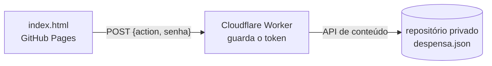

# Mercado em Casa

Controle da despensa de casa, com a lista de compras montada sozinha e a comparação de preços entre mercados. A mesma despensa aparece em todos os celulares da casa.

É uma página só (`index.html`), sem build e sem dependências. Funciona offline e, se você quiser, sincroniza por um Cloudflare Worker que guarda os dados num repositório privado do GitHub.

## O que ele faz

- **Despensa:** item, categoria, onde fica, quantidade, estoque mínimo e validade. Os itens que vencem logo aparecem primeiro.
- **Estado da embalagem:** Fechado, Aberto, Pela metade ou Quase acabando. Um toque no selo troca o estado. "Quase acabando" conta como se aquela unidade já tivesse acabado.
- **Lista de compras:** entra sozinho todo item que chegou no estoque mínimo, com uma quantidade sugerida. Itens avulsos podem ser adicionados à mão. Ao tocar em **Comprei**, a quantidade volta para a despensa, e **Copiar lista** gera o texto para colar no WhatsApp.
- **Carrinho:** você anota item, mercado, preço e quantidade enquanto compra. **Fechar compra** guarda os preços e, se você quiser, soma os itens na despensa.
- **Onde sai mais barato:** usa o último preço anotado de cada item em cada mercado. Mostra o mercado mais barato nos itens que todos têm e quanto custaria comprar cada item onde ele é mais barato.
- **Backup:** exporta e importa um JSON.

## Como funciona



- **Sem sincronização**, tudo fica no `localStorage` do navegador.
- **Com sincronização**, o app conversa só com o Worker. O token do GitHub nunca chega no navegador. O Worker confere a senha da casa, lê e grava o `despensa.json`, e cada gravação vira um commit (`despensa: Leite -1 (Emilly)`). O histórico do repositório é o backup.
- **Cada alteração é uma operação** (`{t: "qtd", id, d: -1}`) com uma chave única. A tela mostra a última versão do servidor mais as operações que ainda não foram enviadas.
- **Conflito:** quando outro aparelho gravou antes, o Worker responde `409` com a versão nova, e o app reaplica as operações por cima dela. Assim, duas pessoas tirando 1 leite ao mesmo tempo dão −2, e não −1.
- **Reenvio sem duplicar:** as chaves das operações já aplicadas ficam gravadas nos dados (`aplicadas`). Se a resposta de uma gravação se perde e o app reenvia, nada é aplicado duas vezes.
- **Ritmo:** os toques são agrupados por 2,5 s num commit só. Os aparelhos conferem a casa a cada minuto e quando o app volta para a tela.

## Instalação

Tudo cabe no plano grátis do GitHub e da Cloudflare.

1. **Repositório dos dados:** crie `mercado-em-casa-dados` como **Private**, com README, para a branch `main` existir.
2. **Token:** GitHub → Settings → Developer settings → Fine-grained tokens. Dê acesso só a `mercado-em-casa-dados`, com **Contents: Read and write**.
3. **Worker:** Cloudflare → Workers & Pages → Create Worker. Cole o `worker/worker.js` e faça o Deploy.
4. **App:** publique este repositório no GitHub Pages (Settings → Pages → `main` / root).
5. **Variáveis do Worker** (Settings → Variables and Secrets) e Deploy de novo:

   | Nome | Tipo | Valor |
   |---|---|---|
   | `SENHA` | Secret | a senha da casa. Use uma longa: o endereço do Worker é público |
   | `GITHUB_TOKEN` | Secret | o token do passo 2 |
   | `REPO` | Text | `seu-usuario/mercado-em-casa-dados` |
   | `ORIGEM_PERMITIDA` | Text | `https://seu-usuario.github.io`, sem caminho e sem barra no fim |
   | `BRANCH`, `ARQUIVO` | Text | opcionais. O padrão é `main` e `despensa.json` |

6. **Conectar:** no app, aba **Casa**, informe o endereço do Worker, a senha e o seu nome, e toque em **Conectar**. Para os outros aparelhos, use **Copiar link de convite**. O link leva o endereço e a senha, então mande só para quem mora com você.

### Se der erro ao conectar

| O app diz | O que conferir |
|---|---|
| Não consegui falar com o servidor | o endereço do Worker e se o `ORIGEM_PERMITIDA` é exatamente a origem do app |
| A senha não confere | a `SENHA`, e se houve Deploy depois de salvar |
| Erro 500 (configuracao) | falta `GITHUB_TOKEN` ou `REPO` |
| Erro 502 (github) | token vencido ou sem permissão, `REPO` errado, ou repositório sem a branch `main` |

### Voltar a despensa de outro dia

No repositório de dados, abra `despensa.json` → History. Escolha o commit, copie o conteúdo do arquivo naquela versão e, no app, use **Casa** → **Importar**. A importação vale para todos os aparelhos.

## Protocolo do Worker

`POST`, com corpo em JSON (o app envia como `text/plain`, para evitar o preflight de CORS).

| Ação | Corpo | Resposta |
|---|---|---|
| ler | `{action: "ler", senha}` | `200 {dados, versao}`. `dados` e `versao` vêm `null` se o arquivo ainda não existe |
| gravar | `{action: "gravar", senha, dados, base, resumo, autor}` | `200 {versao}`, ou `409 {error: "conflito", dados, versao}` quando `base` não é mais a versão atual |

Outras respostas: `401` para senha errada ou `SENHA` não configurada, `400` para corpo inválido, `413` para corpo acima de 900 KB, `502` para falha no GitHub.

## Estrutura

```
index.html        o app inteiro: estilos, interface e o bloco <script id="nucleo">
worker/worker.js  o Worker da Cloudflare
```

O bloco `<script id="nucleo">` não usa o DOM. Ele concentra o formato dos dados, as operações, o motor de sincronização e o comparativo de preços, e dá para testá-lo no Node extraindo esse bloco do HTML.

## Limitações conhecidas

- O comparativo é por embalagem, uma unidade de cada item. "Arroz 5 kg" e "Arroz 1 kg" são itens diferentes.
- Dois produtos são o mesmo quando o nome é igual, sem diferença de maiúsculas, acentos e espaços.
- O `despensa.json` precisa ficar abaixo de 1 MB, que é o limite da API de conteúdo do GitHub. O Worker recusa acima de 900 KB. Isso dá alguns milhares de preços anotados.
- O token do GitHub vence (até 1 ano). Quando vencer, o app mostra "Servidor com erro" até você gerar outro e trocar no Worker.
- A sincronização não é em tempo real: as alterações dos outros aparelhos chegam em até 1 minuto.
